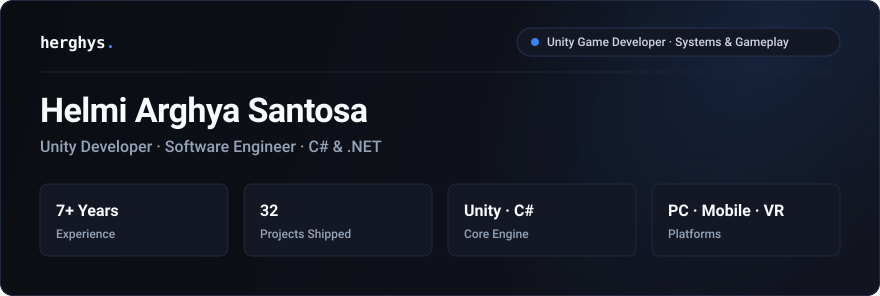

<!-- Auto-synced from herghys.github.io via scripts/sync-profile.mjs -->

  

  
  
  
  
  

---

### About

Unity developer who loves making games, from 2D to 3D, for mobile and desktop. Professional experience includes building VR applications, and independent freelance work covers AR projects and desktop apps.

Day to day, working as a Unity developer, mostly in C# and .NET: building game systems, tools, and extensions, with a focus on clean, reliable code and a smooth experience for the player or user.

Graduated from Yogyakarta State University with a degree in Education. Always learning and keeping up with what’s new in gaming and game technology.

---

### Featured Projects

Selected commercial games, web platforms, and software tools — [browse all 32 projects →](https://herghys.github.io/portfolio/)

<table>
  <tr>
    <td width="50%" valign="top">
      <strong><a href="https://play.google.com/store/apps/details?id=com.HerghysStudio.PongEvolved">Pong Evolved</a></strong> &nbsp;<code>Mobile Game</code>  
      Action arcade mobile game with infinite dynamic levels, retro-modern aesthetic, particle effects, and integrated Google AdMob monetization.  
      Unity3D · C# · Google AdMob
    </td>
    <td width="50%" valign="top">
      <strong><a href="https://play.google.com/store/apps/details?id=com.HerghysStudio.Game.Tap">Tap!</a></strong> &nbsp;<code>Mobile Game</code>  
      Fast-paced reflex and tapping arcade game for mobile, featuring responsive input mechanics, custom audio, and Google AdMob integration.  
      Unity3D · C# · Google AdMob
    </td>
  </tr>
  <tr>
    <td width="50%" valign="top">
      <strong><a href="https://linjunnailart.com/">Linjun Nail Art</a></strong> &nbsp;<code>Web Platform</code>  
      Curated online showcase, product catalog, and digital lookbook for Linjun Nail Art &amp; Eyelashes handmade press-on nail studio.  
      PHP / Laravel · JavaScript · Responsive Web
    </td>
    <td width="50%" valign="top">
      <strong><a href="https://play.google.com/store/apps/details?id=com.newfemmewanitaindonesia.cinda">Cinda: Virtual Dress Up</a></strong> &nbsp;<code>Mobile / AI Game</code>  
      Commercial mobile game featuring 3D avatar generation from selfies, dress-up mechanics, asset bundle streaming, and real-world product rewards.  
      Unity3D · Firebase Auth · Google/Apple Sign-In
    </td>
  </tr>
  <tr>
    <td width="50%" valign="top">
      <strong><a href="https://t.me/DuckieLandBot/DuckieBubbles/">Duckie Bubble</a></strong> &nbsp;<code>Telegram WebApp</code>  
      Bubble shooter game integrated into Telegram Bot WebApps with custom REST API client and WebGL wrapper bridge.  
      Unity WebGL · Telegram API · JSLib / JS
    </td>
    <td width="50%" valign="top">
      <strong><a href="https://github.com/herghys/Keystore-Helper">Keystore Helper</a></strong> &nbsp;<code>Desktop Tool</code>  
      Windows desktop application (WPF) to streamline Android Keystore generation and extract SHA-1 and SHA-256 certificate fingerprints.  
      C# · WPF · .NET
    </td>
  </tr>
</table>

---

### Experience & Credentials

| Role | Organization | Period | Highlights |
| :--- | :--- | :--- | :--- |
| **Unity Programmer** | PT. Falah Inovasi Teknologi | 01/2025 – Present | Engineer high-fidelity 3D and VR simulation applications in Unity3D, developing modular physics-driven simulation systems and real-time trajectory calculation mechanics. |
| **Game Developer (Unity Developer)** | Newfemme Wanita Indonesia | 03/2022 – 08/2024 | Engineered core gameplay and client systems for commercial mobile releases including the Newfemme mobile application and *Cinda: Virtual Dress Up*. |
| **Game & Software Developer (Self-Employed)** | Herghys Studio | 06/2021 – Present | Designed and programmed commercial mobile games on Google Play, including *Pong Evolved* and *Tap!*. |
| **Freelance Game Developer** | PT Teknoreka Inovasi Nusantara | 06/2023 – 08/2023 | Developed 2D WebGL educational games (*SiMurda Edugame*, *Eksponen Edugame*, *Petualangan Qori*) with interactive quizzes and storytelling mechanics. |
| **Game Developer** | Fomuo Games | 02/2023 – 06/2023 | Developed and reskinned casual 2D mobile titles (*Candies Land*, *Baker Pro*, *Blush Tales*, *Blush Crush*, *Crossy Cube*) and Windows 3D prototypes (*Tiny Crash*, *Sky Racer*). |

Full history, education, and credentials: [View Full Resume](https://herghys.github.io/resume/) · [Print View](https://herghys.github.io/resume/print.html) · [PDF (Drive)](https://drive.google.com/file/d/1iT7R5urOa2Cy6RWLIghtDdZzuiWGCR9v/view?usp=sharing) · [Word (Google Docs)](https://docs.google.com/document/d/1N3R4xXBHJcCjPqwFFBBZQ4rzFi425tqI/edit?usp=sharing&ouid=117628878197036348511&rtpof=true&sd=true)

---

### Technical Stack

| Area | Technologies |
| :--- | :--- |
| **Languages** | C#, VB.NET, Java, Python, SQL, JavaScript, HTML5/CSS3, Arduino (C++) |
| **Game Engines & Frameworks** | Unity3D (2018 - Unity 6), Unity Localization, SteamVR, Vuforia AR SDK, Ready Player Me SDK, .NET Core, .NET Framework, Windows Forms, WPF |
| **VR & Hardware Platforms** | HTC Vive Pro 2, Meta Quest (Quest 2 / 3 / Pro), SteamVR SDK |
| **Architecture & Gameplay** | Object-Oriented Design (OOD), State Machines, Object Pooling, Event-Driven Architecture, C# Multithreading, Shader Graph, Cinemachine, URP, Vehicle Physics, Flight Kinematics |
| **Networking & Backend APIs** | RESTful APIs, UnityWebRequest, JSON Serialization, Mirror Networking, Netcode for GameObjects, Telegram API |
| **SDKs & Third-Party Services** | Firebase SDK (Authentication, Analytics, Cloud Messaging), Google Sign-In, Apple Sign-In, Facebook SDK, Google AdMob, Unity IAP, Google In-App Update |
| **Development Tools & Platforms** | Git, GitHub, Visual Studio, VS Code, Postman, Android Studio, Unity Profiler, Figma |

---

### GitHub Activity

  
  

---

### Connect

Get in touch for game engineering, collaboration, or inquiries:

- **Email:** [helmi.santosa1@gmail.com](mailto:helmi.santosa1@gmail.com)
- **WhatsApp:** [+62 877-7113-9889](https://wa.me/+6287771139889)
- **LinkedIn:** [linkedin.com/in/herghys](https://www.linkedin.com/in/herghys)
- **Portfolio:** [herghys.github.io](https://herghys.github.io/)
- **Steam:** [steamcommunity.com/id/herghys](https://steamcommunity.com/id/herghys)
